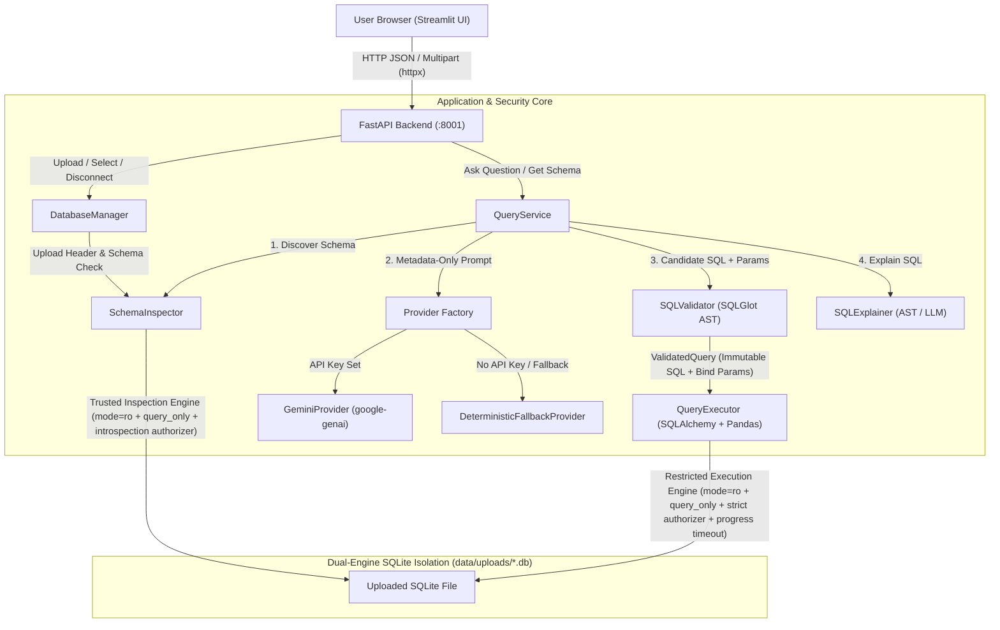

# QueryMind Architecture

QueryMind is designed as a modular, layered Natural Language to Read-Only SQL system with explicit trust boundaries between user input, LLM generation, AST validation, and database execution.

## System Overview

---

## Component Responsibilities

### 1. Streamlit Frontend (`src/querymind/ui/`)
- **Role:** Thin presentation layer (`streamlit_app.py`, `api_client.py`, and `components/`).
- **Behavior:** Communicates exclusively with FastAPI over HTTP (`QueryMindAPIClient` via `httpx`), defaulting to `http://127.0.0.1:8001` (overridable via `QUERYMIND_API_URL`). Never opens SQLite files directly and never accesses LLM API keys.
- **Screens:** Renders a welcome/upload screen when no database is active (`upload_welcome.py`), a Database Library with switching/disconnect controls, an expandable schema browser (`schema_sidebar.py`), dynamic schema-derived prompt suggestions (`query_panel.py`), and validated SQL, explanation, Pandas table, and CSV download views (`results_view.py`).

### 2. FastAPI Backend (`src/querymind/api/`)
- **Role:** Versioned REST interface (`app.py`, `dependencies.py`, `routes/`).
- **Endpoints:**
  - `GET /api/v1/health` — Reports backend readiness, active database connection status/display name, and active provider mode (never secrets or filesystem paths).
  - `GET /api/v1/databases`, `POST /api/v1/databases/upload`, `POST /api/v1/databases/upload-batch`, `POST /api/v1/databases/select`, `POST /api/v1/databases/disconnect` — Manages uploaded SQLite databases.
  - `GET /api/v1/schema`, `POST /api/v1/schema/refresh` — Returns or refreshes the discovered `SchemaSnapshot`.
  - `POST /api/v1/query` — Executes the NL-to-SQL pipeline.
- **Error Handling:** Global exception handlers map typed `QueryMindError` subclasses to HTTP status codes (`400`, `413`, `502`, `503`, `504`) and scrub secrets and local filesystem paths via `sanitize_error_message()`.

### 3. Database Manager (`src/querymind/db/manager.py`)
- **Role:** Handles single-file (`upload_and_connect`) and multi-file (`upload_batch`) SQLite uploads, library listing, switching, and disconnecting.
- **Validation & Isolation:**
  - Rejects filenames with path traversal tokens (`..`, `/`, `\`, `:`, null bytes) and extensions outside `.db`, `.sqlite`, `.sqlite3`.
  - Enforces backend resource caps: max 15 files per batch, max 25 MB per file, and max 100 MB total batch size.
  - Verifies the 16-byte `SQLite format 3\x00` header, writes to collision-safe unique filenames inside `data/uploads/`, inspects tables via `SchemaInspector`, and rejects 0-table databases (removing failed staged files).
  - Isolates per-file failures during batch uploads so one invalid file does not block valid files, and rolls back safely if switching databases fails.

### 4. Schema Inspector (`src/querymind/db/inspector.py`)
- **Role:** Automatically discovers tables, column names, types, nullability, primary keys, and foreign keys using SQLAlchemy `inspect()`.
- **Trusted Inspection Engine:** Uses `create_inspection_engine()` (`mode=ro`, `PRAGMA query_only = ON`, and an inspection-scoped `sqlite3.set_authorizer()` allowing only read-only schema introspection pragmas and `sqlite_schema`/`sqlite_master`). Caches the `SchemaSnapshot` in memory until refreshed or switched.

### 5. LLM Provider Abstraction (`src/querymind/llm/`)
- **Role:** Decouples query orchestration from specific AI vendors via the `BaseLLMProvider` protocol (`generate_sql`, `explain_sql`).
- **`PromptBuilder` (`prompts.py`):** Builds prompts exclusively from structural `SchemaSnapshot` metadata (table/column names, types, PK/FK relationships)—never sending database row contents to external LLMs.
- **`GeminiProvider` (`providers/gemini_provider.py`):** Calls Google Gemini (`google-genai`) requesting structured JSON (`sql`, `explanation`) and sanitizes any error messages with the API key redacted.
- **Factory (`factory.py`):** Selects `GeminiProvider` when configured with an API key, or `DeterministicFallbackProvider` when in `fallback` or `auto` mode without a key.

### 6. Deterministic Fallback Provider (`src/querymind/llm/providers/fallback.py`)
- **Role:** Offline, zero-API-key NL-to-SQL engine using schema-aware matching and SQLGlot AST construction.
- **Supported Capabilities:** Single-table `SELECT`, `COUNT`/`SUM`/`AVG` aggregations, parameterized `WHERE` comparisons (`=`, `>`, `<`, `>=`, `<=`), `ORDER BY` + `LIMIT`, `GROUP BY`, and two-table `JOIN`s strictly along discovered foreign keys. Unsupported patterns fail explicitly with `UnsupportedDeterministicQueryError`.

### 7. SQLGlot Validator (`src/querymind/security/validator.py`)
- **Role:** Mandatory AST security gate between SQL generation and execution.
- **Checks:**
  - Rejects empty inputs, parse errors (fail-closed), and multi-statement batches.
  - Allows only `SELECT`, `WITH ... SELECT` (non-recursive), and `UNION`/`INTERSECT`/`EXCEPT` over `SELECT`s.
  - Blocks `INSERT`, `UPDATE`, `DELETE`, `DROP`, `ALTER`, `CREATE`, `PRAGMA`, `ATTACH`, `DETACH`, `sqlite_*`/`pragma_*` system tables, `WITH RECURSIVE`, and unapproved functions.
  - Resolves table/column references against lexical scopes (`FROM`, `JOIN`, CTE projections, derived subqueries, and SQLite `SELECT` alias rules in `GROUP BY`/`HAVING`/`ORDER BY`), rejecting unknown or ambiguous columns.
  - Injects or clamps `LIMIT` to `max_rows` and extracts scalar literals into `:p_N` named bind parameters, outputting an immutable `ValidatedQuery` (`MappingProxyType` params verified to match SQL placeholders 1:1).

### 8. Read-Only SQL Executor (`src/querymind/db/executor.py` & `db/engine.py`)
- **Role:** Executes `ValidatedQuery` objects against `create_execution_engine()`.
- **Protections:** Enforces `?mode=ro`, `PRAGMA query_only = ON`, and a strict default-deny execution authorizer (denying all `PRAGMA`s, writes, DDL, `ATTACH`, `sqlite_*` tables, and unapproved functions). Attaches `sqlite3.Connection.set_progress_handler` to abort slow queries on timeout, caps memory with `fetchmany(limit + 1)`, and normalizes rows via Pandas `DataFrame` (`NullPool` disposes connections immediately after use).

### 9. Query Service (`src/querymind/services/query_service.py`)
- **Role:** Thread-safe orchestrator connecting `SchemaInspector`, active `BaseLLMProvider`, `SQLValidator`, `QueryExecutor`, and `SQLExplainer`. Enforces that `QueryExecutor.execute()` is only ever called with a `ValidatedQuery` produced by `SQLValidator.validate()`. Manages atomic database switching and rollback on failed connection attempts.

### 10. SQL Explainer (`src/querymind/explainer/explainer.py`)
- **Role:** Generates plain-English explanations of validated SQL queries without reading table row contents.
- **Behavior:** Uses the LLM provider's `raw_explanation` when generated in Gemini mode, or `explain_from_ast()` which inspects the SQLGlot AST to summarize CTEs, projections, `FROM` tables, `JOIN`s, `WHERE` filters, `GROUP BY`, `HAVING`, `ORDER BY`, and `LIMIT` clauses.

---

## Architectural Limitations

- **Single-User Local State:** Active database selection and the uploaded database registry are stored in process memory (`app.state`), not scoped per authenticated user session.
- **SQLite-Only Execution:** Currently targets SQLite databases (`?mode=ro` + `set_authorizer`). Adding PostgreSQL or MySQL later will require server-side read-only roles and statement timeouts.
- **Defense-in-Depth Scope:** Controls mitigate known attack classes tested in `tests/security/`, rather than offering absolute security guarantees; public multi-user deployment requires adding authentication, session isolation, rate limiting, and upload retention policies.
